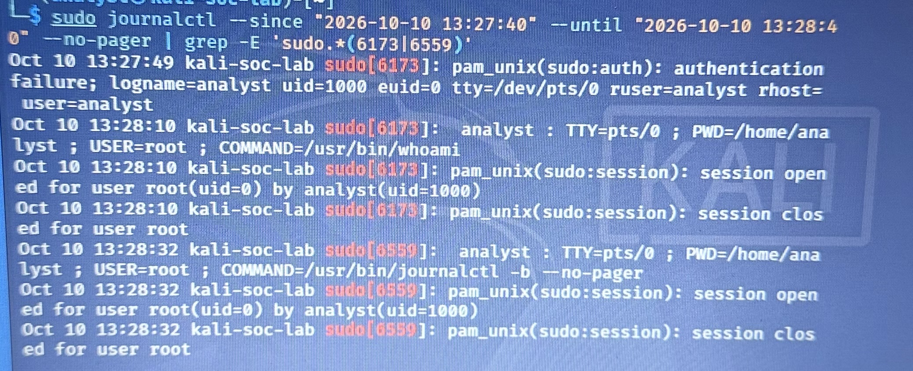

# SOC-001 — Failed Privileged Authentication Investigation

**Status:** Completed controlled exercise  
**Environment:** Kali Linux VM (`kali-soc-lab`) in VirtualBox, NAT networking  
**Investigation type:** Linux authentication log review and event correlation  
**Evidence status:** Supplied timestamped journal transcriptions and a published phone photograph of the terminal, linked below. An independently exported raw journal file is unavailable.

## Objective
Generate and investigate an authorized failed privileged authentication attempt and determine whether the event should be treated as suspicious activity or expected test behavior.

## Lab context
The exercise used the `analyst` account on a personally controlled Kali Linux VM. A deliberately incorrect password was entered for a `sudo` operation, followed by a successful authorized `sudo` operation. The analyst inspected Linux journal entries to correlate the activity.

## Observed sequence
1. Initiated a privileged action with `sudo`.
2. Entered an incorrect password, producing a failed authentication event.
3. Performed a successful `sudo` authentication afterward.
4. Reviewed `journald` records and correlated the failure and success as one authorized test sequence.

## Verified event timeline (October 10, 2026)

| Recorded local time | Event | Evidence |
| --- | --- | --- |
| 13:27:49 | PAM authentication failure | `sudo[6173]`, account `analyst`, `tty=/dev/pts/0` |
| 13:28:10 | Privileged command `/usr/bin/whoami` logged | `sudo[6173]`, `USER=root`, `TTY=pts/0` |
| 13:28:10 | Root session opened then closed | `pam_unix(sudo:session)`, PID 6173 |
| 13:28:32 | Follow-up journal review | `sudo[6559]`, `COMMAND=/usr/bin/journalctl -b --no-pager` |

The failed authentication and successful privileged command occurred **21 seconds apart** and share **PID 6173**. This supports correlation to the same `sudo` process, not a separate unverified login. The supplied journal timestamps do not specify a timezone; no offset is inferred.

### Supplied journal evidence

```text
Oct 10 13:27:49 kali-soc-lab sudo[6173]: pam_unix(sudo:auth): authentication failure; logname=analyst uid=1000 euid=0 tty=/dev/pts/0 ruser=analyst rhost=  user=analyst
Oct 10 13:28:10 kali-soc-lab sudo[6173]:  analyst : TTY=pts/0 ; PWD=/home/analyst ; USER=root ; COMMAND=/usr/bin/whoami
Oct 10 13:28:10 kali-soc-lab sudo[6173]: pam_unix(sudo:session): session opened for user root(uid=0) by analyst(uid=1000)
Oct 10 13:28:10 kali-soc-lab sudo[6173]: pam_unix(sudo:session): session closed for user root
Oct 10 13:28:32 kali-soc-lab sudo[6559]:  analyst : TTY=pts/0 ; PWD=/home/analyst ; USER=root ; COMMAND=/usr/bin/journalctl -b --no-pager
```

These excerpts were supplied from the user's lab output. The published terminal photograph visibly supports the listed timestamps, PIDs, and command sequence. Neither the live journal nor an independently exported journal file is available to authenticate acquisition; the event timezone remains unspecified.

## Analysis
A single failed `sudo` authentication event can occur because of user error, an authorized test, or malicious attempts to gain elevated privileges. The nearby successful event and known testing context support classifying this sequence as authorized lab activity. The evidence described here does not establish brute-force activity, compromise, or unauthorized access.

## Disposition
**Authorized simulation / no confirmed security incident.** This disposition applies only to the controlled lab sequence described above, not to arbitrary authentication failures on production systems.

## Detection and investigation workflow
- Identify relevant `sudo` and authentication records in the Linux journal.
- Correlate event order and user context.
- Assess whether the observed sequence matches the authorized test.
- Record the conclusion and limitations.

Example commands for **future evidence collection** (not claimed as the original commands used):

```bash
sudo journalctl --no-pager | grep -Ei 'sudo|authentication failure'
sudo journalctl --since 'today' --no-pager | grep -Ei 'sudo|authentication failure'
```

These commands may require adapting the time range or journal access permissions.

## Original terminal photograph and provenance



*User-supplied phone photograph of the Kali terminal, showing the journal query and authentication sequence. The displayed file is the unchanged published original; no crop, text replacement, enhancement, or resizing was applied during this remediation. It is photographic evidence, not an unedited digital screenshot or an independently authenticated journal export.*

The [unchanged published original](../SOC-001-authentication-evidence.png) has a legacy `.png` filename but contains JPEG/MPO bytes with two frames, including an auxiliary grayscale terminal frame. Both frames are preserved in that file and in the [accurately named MPO copy](../evidence/SOC-001/SOC-001-terminal-original.mpo), which reuses the same repository blob. Camera/device/software and capture-time metadata remain in the original; no GPS fields were found in the audit or remediation inspection. Capture metadata does not establish the timezone of the journal events. The MPO copy retains both frames and all original metadata; no metadata stripping or visible-text redaction is claimed. See the [copy provenance record](../evidence/SOC-001/display-provenance.json) and [evidence handling policy](../docs/evidence-handling.md).

## Archived AI illustration

The [historical AI-generated reconstruction](../SOC-001-illustrative-reconstruction.png) is retained unchanged but removed from the evidence display. Its final session line incorrectly reads `dodo[6559]`; the photograph shows `sudo[6559]`. Use the photograph and transcribed records for that event. The image has no embedded illustration label and must not be shared detached from this provenance statement. It is not primary evidence.

## Evidence status and remaining limits
- [x] Timestamped failed authentication excerpt (user-supplied)
- [x] Timestamped successful `sudo` excerpt (user-supplied)
- [x] Event timeline based on recorded timestamps
- [x] Correlation by PID, terminal and account; timestamp timezone not provided
- [x] Published original terminal photograph and accurately named byte-identical MPO copy
- [ ] Independently exported raw journal file and historical acquisition record (unavailable; not reconstructed)

## Lessons learned
- Authentication failures require context before escalation.
- Correlating adjacent events helps distinguish mistakes and controlled tests from potential threats.
- A defensible case report records both the finding and what evidence is missing.

## Future collection

SOC-002 through SOC-004 now have published reports. New collections can record raw exports, absolute timestamps with timezone, and hashes following the [newly proposed walkthrough](../docs/reproduction.md). New records would supplement this case; they cannot recreate missing historical acquisition evidence.
