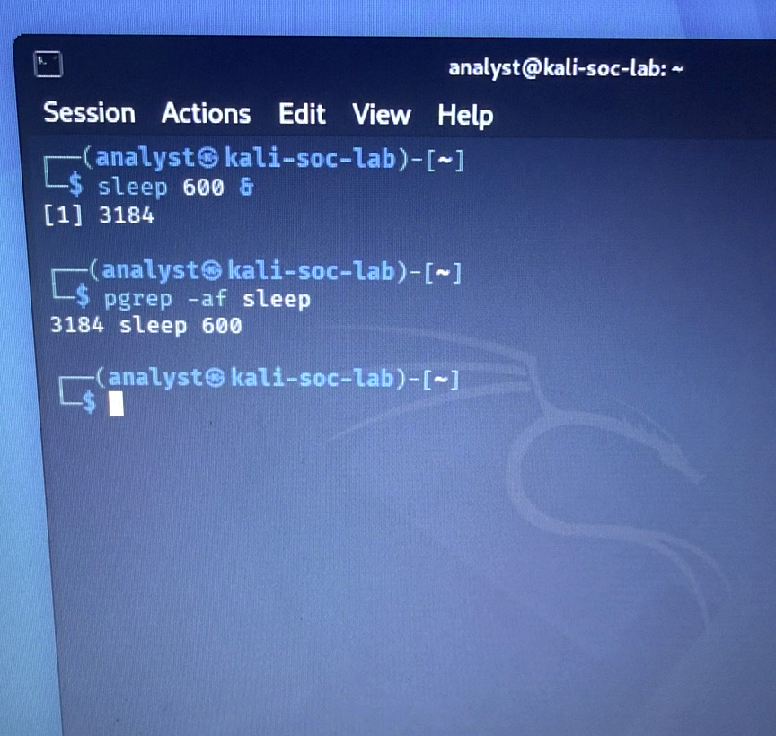
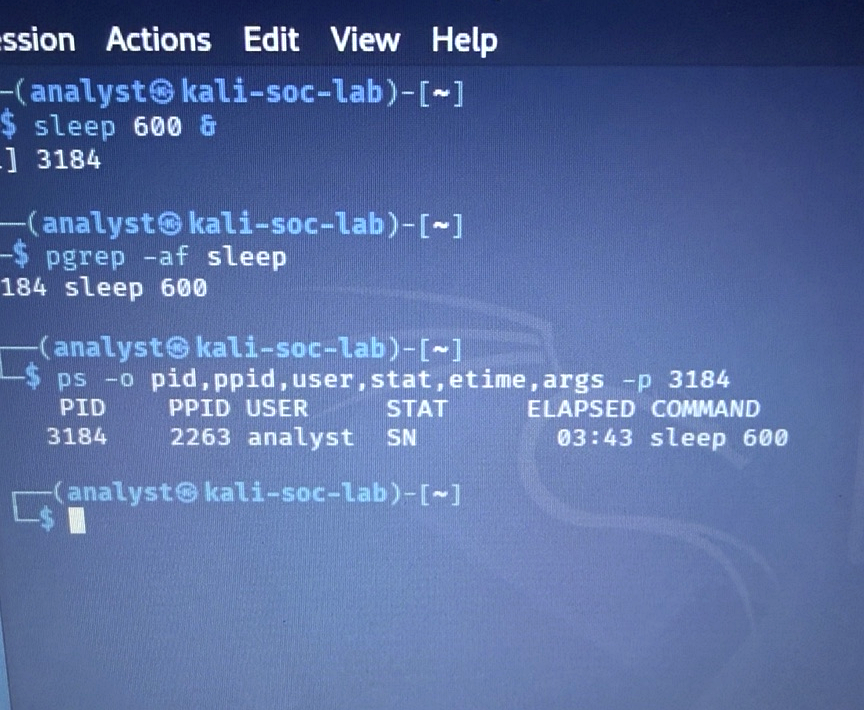
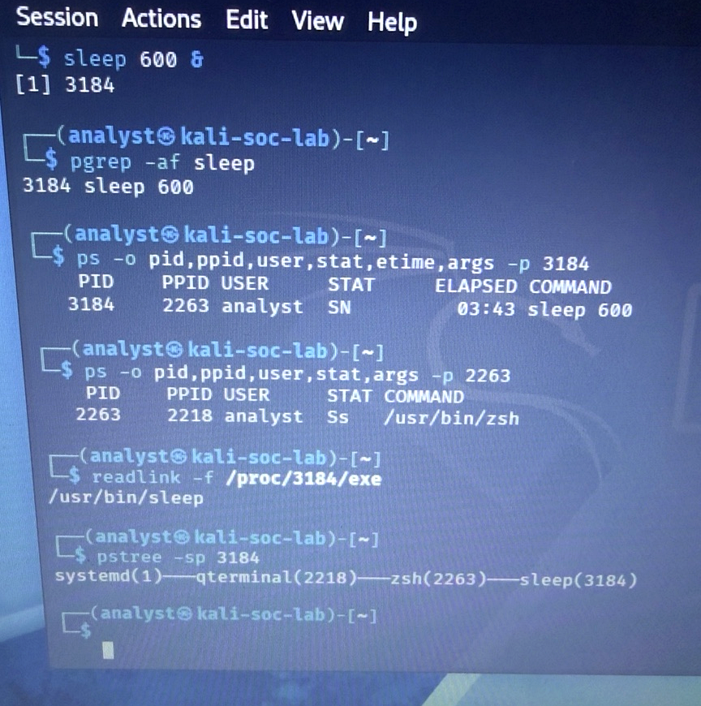
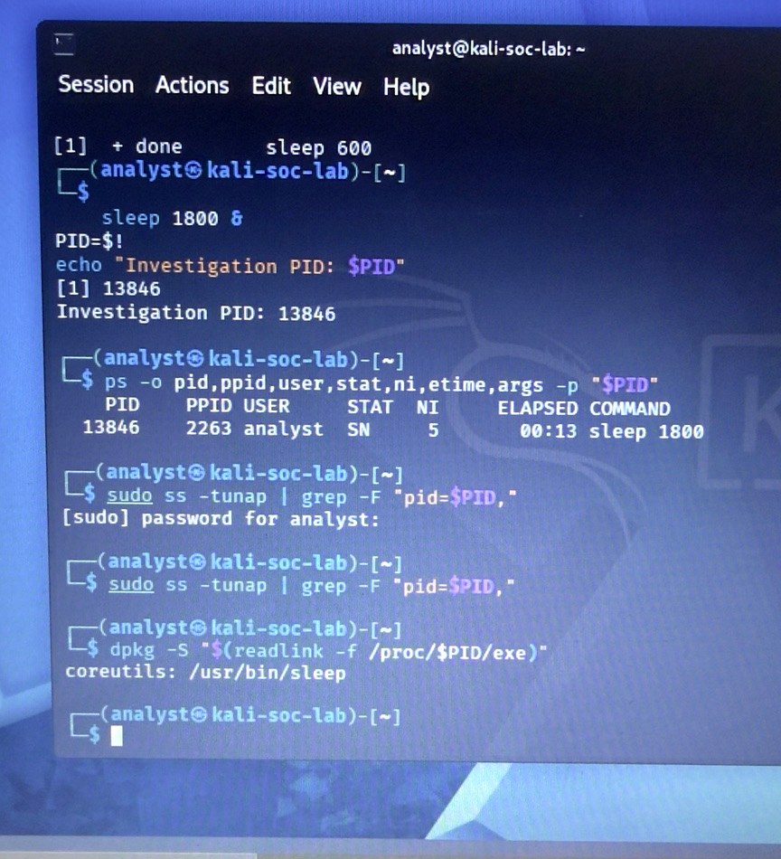

# SOC-002 — Suspicious Process Investigation

**Status:** Completed controlled exercise  
**Investigation type:** Linux process triage, ancestry review, socket snapshot, and package checks  
**Disposition:** Authorized controlled simulation / no confirmed security incident  
**Evidence status:** User-provided lab observations and four enhanced photographs of the original terminal display. The photographs were cropped and adjusted for readability; original log text was not regenerated.

## Objective and scope

Investigate a process selected for an authorized lab exercise by reviewing its metadata, parent process, executable path, visible sockets, and package ownership. Assess whether the supplied evidence supports escalation to a confirmed incident.

This report documents only the user's verified lab evidence. The observations were supplied by the user and were not independently reproduced for this report. The initial `sleep 600` process and the follow-up `sleep 1800` process have different PIDs and are treated as separate observations.

## Verified lab evidence

### Initial process: PID 3184

The user supplied output from `ps -o pid,ppid,user,stat,etime,args -p 3184` with the following values:

| Field | Observed value |
| --- | --- |
| Command | `sleep 600` |
| PID | `3184` |
| PPID | `2263` |
| User | `analyst` |
| State | `SN` |
| Elapsed time | `03:43` |

The parent process was `zsh`, PID `2263`, with parent `qterminal`, PID `2218`. The supplied hierarchy was:

```text
systemd(1) -> qterminal(2218) -> zsh(2263) -> sleep(3184)
```

The executable associated with `/proc/3184/exe` resolved to `/usr/bin/sleep`.

### Follow-up process: PID 13846

The user supplied the following process metadata:

| Field | Observed value |
| --- | --- |
| Command | `sleep 1800` |
| PID | `13846` |
| PPID | `2263` |
| User | `analyst` |
| State | `SN` |
| Nice value | `5` |
| Elapsed time | `00:13` |

The follow-up shares parent PID `2263` with the initial process. The ancestry shown above was collected for PID `3184`; a separate full hierarchy or executable-link result for PID `13846` is not claimed.

### Socket and package checks

| Check | User-reported result |
| --- | --- |
| `sudo ss -tunap \| grep -F "pid=$PID,"` for follow-up PID `13846` | No matching output |
| `dpkg -S /usr/bin/sleep` | `coreutils: /usr/bin/sleep` |
| `dpkg -V coreutils` | No output |

The empty results are recorded as reported observations. No unfiltered socket listing or command exit status was supplied. The behavioral-analysis photograph documents the filtered command and associated package-ownership check; the `dpkg -V coreutils` result was separately user-reported.

## Photographic evidence

The following images are enhanced versions of user-supplied phone photographs of the Kali terminal (cropping, brightness, contrast, and sharpness adjustments). They are **not AI-generated reconstructions**. They supplement, rather than replace, the reported terminal output.

**Evidence 1 — Process discovery (PID 3184)**



**Evidence 2 — Process metadata (PID 3184)**



**Evidence 3 — Parent process and ancestry**



**Evidence 4 — Follow-up process, socket filter, and package ownership (PID 13846)**



The reported no-output result of `dpkg -V coreutils` is not independently substantiated by these four photographs.

## Analysis

### Process metadata and ancestry

`S` denotes interruptible sleep; `N` denotes low scheduling priority. The follow-up nice value of `5` is consistent with the `N` flag. These state and priority values describe scheduling behavior and do not identify malware. The elapsed values `03:43` and `00:13` describe process age at their respective observations, not wall-clock timestamps. These field meanings follow the [procps ps manual](https://manpages.debian.org/bookworm/procps/ps.1.en.html).

The recorded chain places PID `3184` under the `analyst` account's shell in a terminal session. Together with the authorized exercise context and the observed executable path, this is consistent with a controlled lab command. Ancestry and an expected path alone do not prove that a process is trustworthy or establish everything it did.

### Socket snapshot and limitations

The reported command requests TCP and UDP sockets, including listening and non-listening sockets, with numeric addresses and process information. The filter then selects lines containing the target PID token. See the [iproute2 ss manual](https://manpages.debian.org/bookworm/iproute2/ss.8.en.html) for the option meanings.

No matching line was reported for PID `13846` in that snapshot. This does not establish that the process never communicated: earlier, later, or short-lived sockets may be missed. The selected protocols and the current network namespace limit visibility, and the filter depends on process information being available and the intended PID being set. It does not assess other processes or all forms of communication. Without the unfiltered output and exit statuses, the empty result alone cannot confirm that every stage of the check succeeded.

### Package ownership and verification limitations

`dpkg -S` associates `/usr/bin/sleep` with the installed `coreutils` package in the local package database. Ownership identifies the recorded package; it does not authenticate the current file or establish its runtime behavior.

The user reported no output from `dpkg -V coreutils`, so no discrepancies were reported by that check. Verification compares supported file information with local package metadata; the documented content check uses stored MD5 sums where available. Coverage depends on available metadata, and the local database is not an independent trusted reference. The check does not assess process memory, behavior, or unrelated files. No exit status, package version, or independent file hash was supplied, so no stronger integrity conclusion is claimed. See the [Debian dpkg manual](https://manpages.debian.org/bookworm/dpkg/dpkg.1.en.html).

## Disposition

**Authorized controlled simulation / no confirmed security incident.** There is **no evidence of malware in the supplied lab observations**. The documented metadata, ancestry, executable path, empty socket filter result, and package results are consistent with the controlled exercise. They do not establish that the entire system is free of malware.

No further incident escalation is warranted on this evidence for the authorized exercise. The case report is complete within the documented scope. Any future escalation would require additional evidence that contradicts the authorized activity or shows suspicious behavior.

## Evidence limitations

- No absolute collection timestamps or timezone were supplied; only process elapsed times are documented.
- The two process snapshots are separate observations; the follow-up checks are not attributed retroactively to PID `3184`.
- Four enhanced photographs are linked; no original unedited digital screenshots, raw exported evidence files, or independent reproduction are claimed.
- No broader host compromise assessment, persistence review, or continuous network monitoring is claimed.

## Lessons learned

- Correlate PID, parent PID, account, command, and executable path before deciding whether a process needs escalation.
- Interpret scheduling state and nice values in context.
- Treat package ownership, package verification, and socket snapshots as bounded observations.
- Record what the evidence supports and preserve its limitations.
