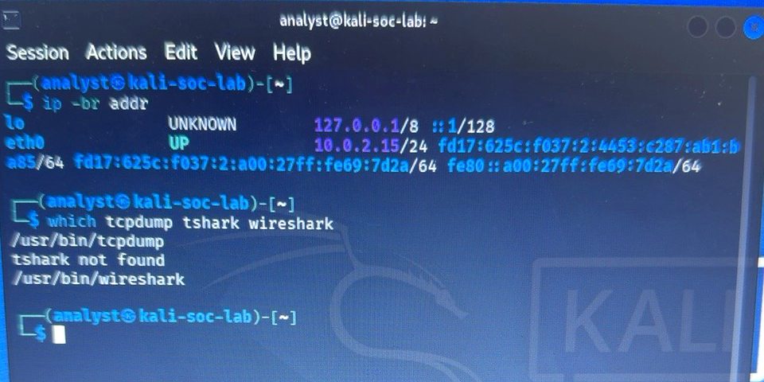
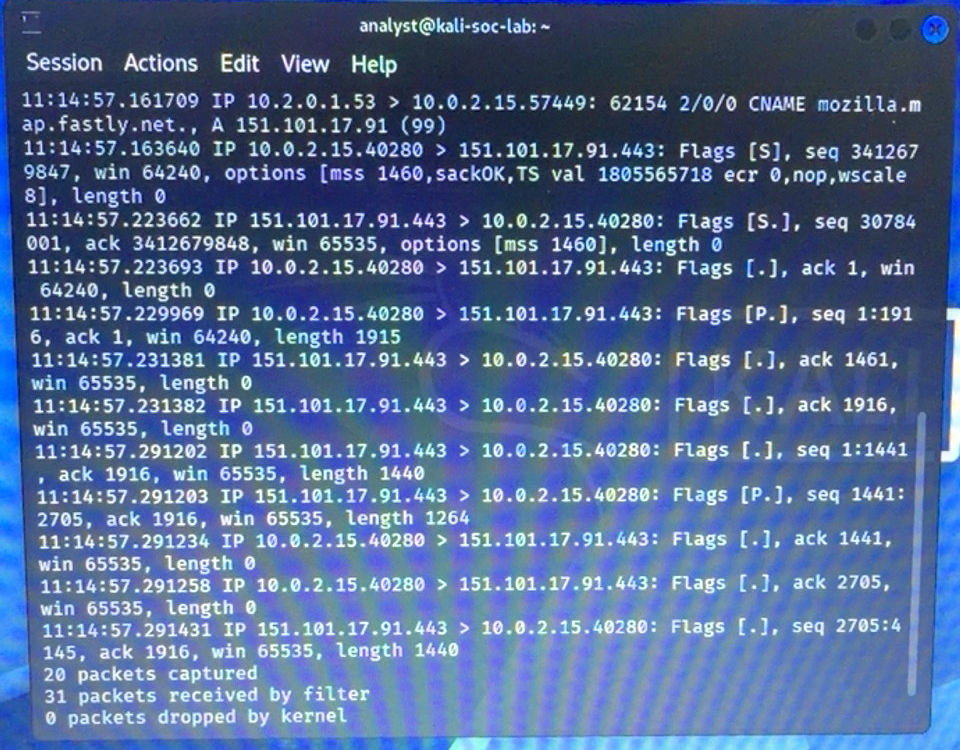
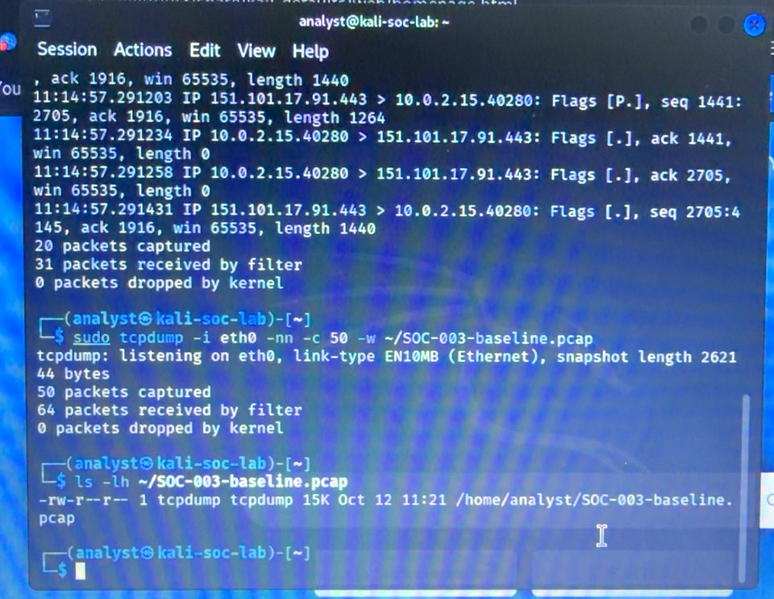
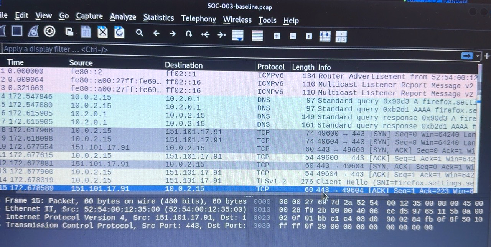
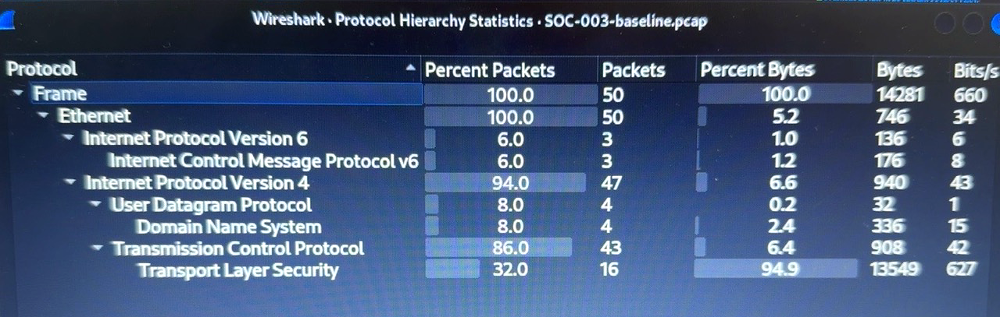
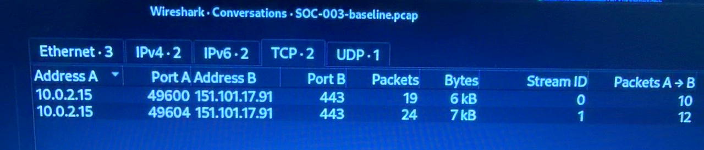
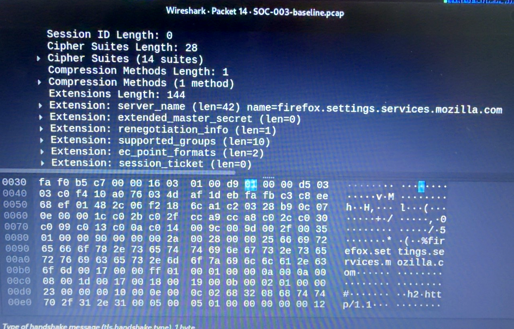
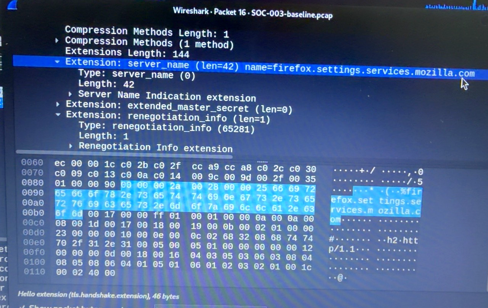
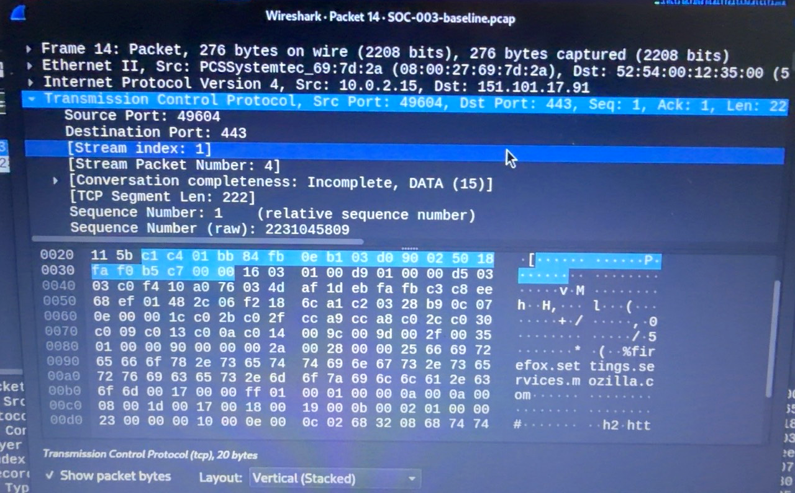
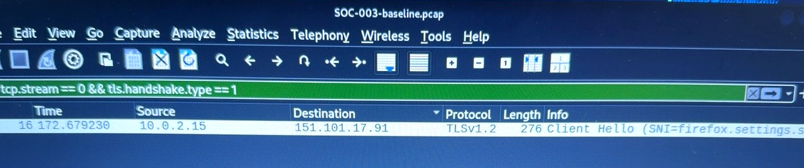

# SOC-003 — Network Traffic Investigation

**Status:** Completed controlled baseline exercise  
**Environment:** Kali Linux VM `kali-soc-lab`, user `analyst`, VirtualBox  
**Disposition:** Authorized baseline traffic; no confirmed security incident  
**Evidence basis:** User-supplied photographs of terminal and Wireshark output. The PCAP remains local and has not been independently examined by the report author.

## Objective

Capture and triage a small sample of network traffic; characterize protocols, TCP conversations and TLS handshakes without inferring compromise from ordinary connectivity.

## Collection and preservation

- `ip -br addr`: `eth0` UP, IPv4 `10.0.2.15/24`.
- Tools: `/usr/bin/tcpdump` and `/usr/bin/wireshark` available; `tshark` not found.
- Initial terminal capture: `sudo tcpdump -i eth0 -nn -c 20`; 20 packets captured, 31 received by filter, zero kernel drops.
- Saved capture: `sudo tcpdump -i eth0 -nn -c 50 -w ~/SOC-003-baseline.pcap`; 50 packets captured, 64 received by filter, zero kernel drops.
- `ls -lh` showed `/home/analyst/SOC-003-baseline.pcap`, approximately 15 KB, permissions `-rw-r--r--`, owned by `tcpdump:tcpdump`. The Wireshark Protocol Hierarchy showed 14,281 captured bytes.
- The PCAP was not uploaded publicly because packet captures may contain sensitive metadata or payloads. No cryptographic hash or independent integrity verification was supplied.

## Protocol hierarchy

Wireshark reported 50 frames total (14,281 bytes). Hierarchical counts **overlap** and must not be summed:

| Protocol | Packets | Share of frames |
| --- | ---: | ---: |
| IPv4 | 47 | 94% |
| IPv6 / ICMPv6 | 3 | 6% |
| TCP | 43 | 86% |
| UDP / DNS | 4 | 8% |
| TLS | 16 | 32% |

The observed IPv6 control traffic included router advertisement and multicast listener reports. DNS traffic included Firefox settings-related queries and responses.

## TCP conversations

Wireshark **Statistics → Conversations → TCP** showed two streams, both targeting `151.101.17.91:443`:

| Stream | Local endpoint | Remote endpoint | Packets | Approx. captured bytes |
| --- | --- | --- | ---: | ---: |
| 0 | `10.0.2.15:49600` | `151.101.17.91:443` | 19 | 6 KB |
| 1 | `10.0.2.15:49604` | `151.101.17.91:443` | 24 | 7 KB |

The 43 packets across the two streams match the reported TCP total. A TCP SYN, SYN-ACK and ACK sequence was visible in the baseline. Packet payload exchange and acknowledgments were also visible. Port 443 is consistent with HTTPS but is not, by itself, proof of benign traffic.

## TLS analysis

The user applied the Wireshark display filter `tls.handshake.type == 1` and inspected the TLS Client Hello messages.

- **Packet 14:** `10.0.2.15:49604 → 151.101.17.91:443`, TCP **stream 1**. An expanded Client Hello showed SNI `firefox.settings.services.mozilla.com`.
- **Packet 16:** `10.0.2.15:49600 → 151.101.17.91:443`, TCP **stream 0**. An expanded Client Hello showed the same SNI `firefox.settings.services.mozilla.com`.
- The displayed Client Hello included cipher suites and TLS extensions. Wireshark labeled the packet protocol TLS 1.2; this does not by itself establish the final negotiated TLS version or successful completion of either handshake.

SNI identifies the hostname the client requested; it does not independently authenticate the server or reveal encrypted application content.

## Analysis and disposition

The observed DNS responses, two TCP connections to port 443, and Client Hello SNI values are **consistent with ordinary Firefox settings-related traffic**. No confirmed indicator of compromise was identified in this limited sample.

**Disposition: Authorized baseline exercise / no confirmed security incident.** This finding applies only to the reviewed 50-packet capture and supplied screenshots. It does not establish that the remote endpoint, all traffic, or the host is free of malicious activity.

## Evidence limitations and handling

- Observations were supplied through photographs of the terminal and Wireshark; the underlying PCAP was not directly available for independent inspection.
- No full payload review, TLS decryption, destination attribution independent of SNI, or comprehensive threat-intelligence validation was performed.
- No absolute collection timestamp with timezone or capture-file cryptographic hash was documented.
- The original PCAP should remain private until reviewed for sensitive content; screenshots may be added to the repository separately with accurate captions and without representing them as unedited digital captures.

## Lessons learned

- Preserve a PCAP instead of relying solely on live terminal output.
- Interpret Wireshark protocol hierarchy as nested, not additive.
- Correlate conversations with TCP stream indexes and TLS Client Hello messages.
- Distinguish normal-looking traffic from a proven absence of compromise.

## Photographic evidence gallery

These are user-supplied photographs of the Kali terminal and Wireshark screen, processed for readability. They document visible application output; they are not raw packet exports, independently authenticated captures, or AI-generated recreations. The underlying PCAP remains private.

### Evidence 01 — Network interface discovery: eth0 UP and installed capture tools.

*Network interface discovery: eth0 UP and installed capture tools.*

### Evidence 02 — Initial tcpdump capture and packet summary.

*Initial tcpdump capture and packet summary.*

### Evidence 03 — Saved 50-packet PCAP and local file listing.

*Saved 50-packet PCAP and local file listing.*

### Evidence 04 — Wireshark packet list showing DNS, TCP, TLS, and ICMPv6.

*Wireshark packet list showing DNS, TCP, TLS, and ICMPv6.*

### Evidence 05 — Protocol hierarchy statistics for 50 captured frames.

*Protocol hierarchy statistics for 50 captured frames.*

### Evidence 06 — Two TCP conversations with the same remote IP and destination port 443.

*Two TCP conversations with the same remote IP and destination port 443.*

### Evidence 07 — TLS Client Hello and Mozilla settings SNI details.

*TLS Client Hello and Mozilla settings SNI details.*

### Evidence 08 — Second Client Hello SNI inspection, packet 16.

*Second Client Hello SNI inspection, packet 16.*

### Evidence 09 — TCP stream index 1 inspection for packet 14.

*TCP stream index 1 inspection for packet 14.*

### Evidence 10 — TCP stream 0 Client Hello verification for packet 16.

*TCP stream 0 Client Hello verification for packet 16.*
