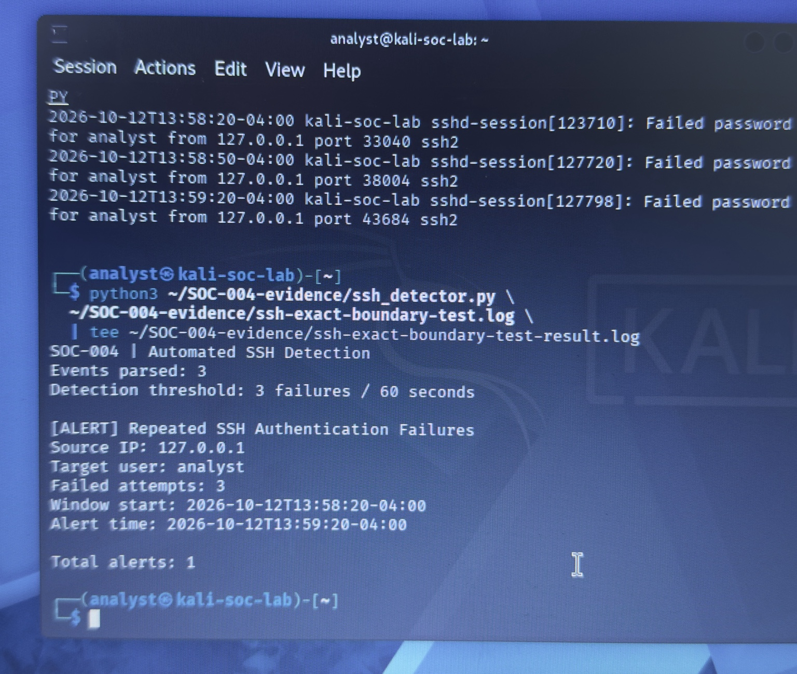
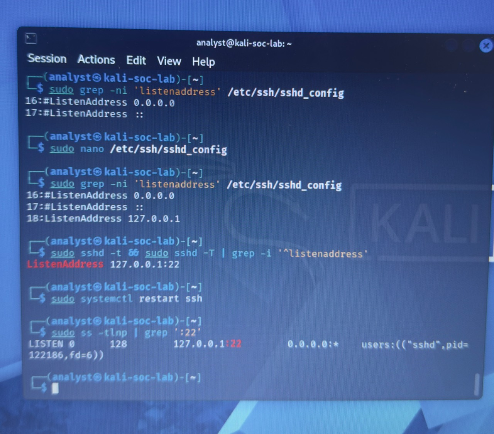
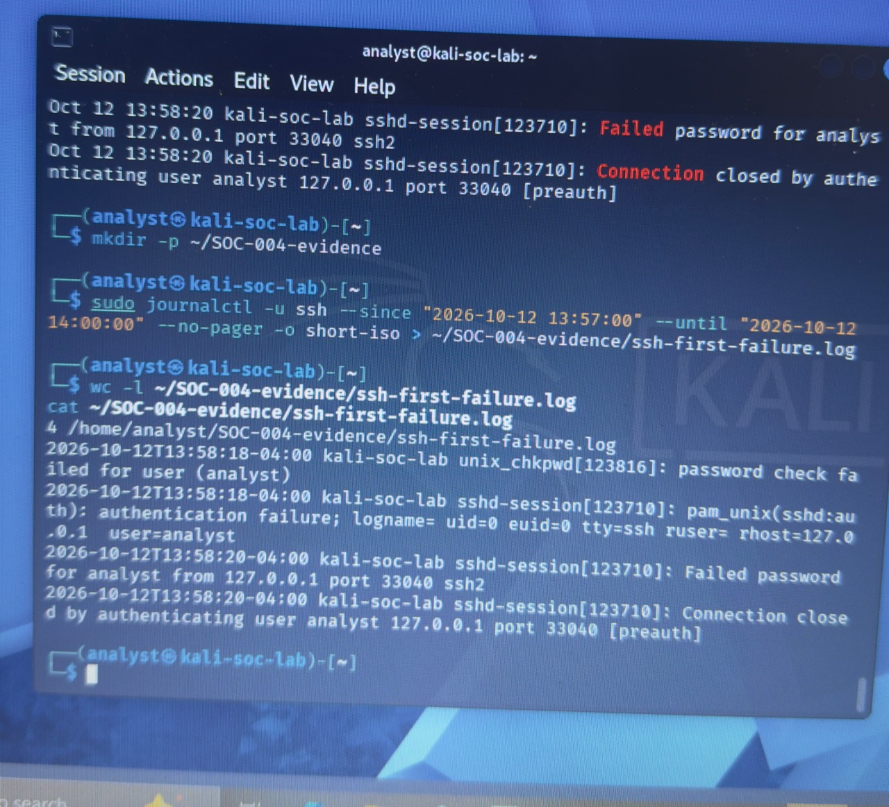
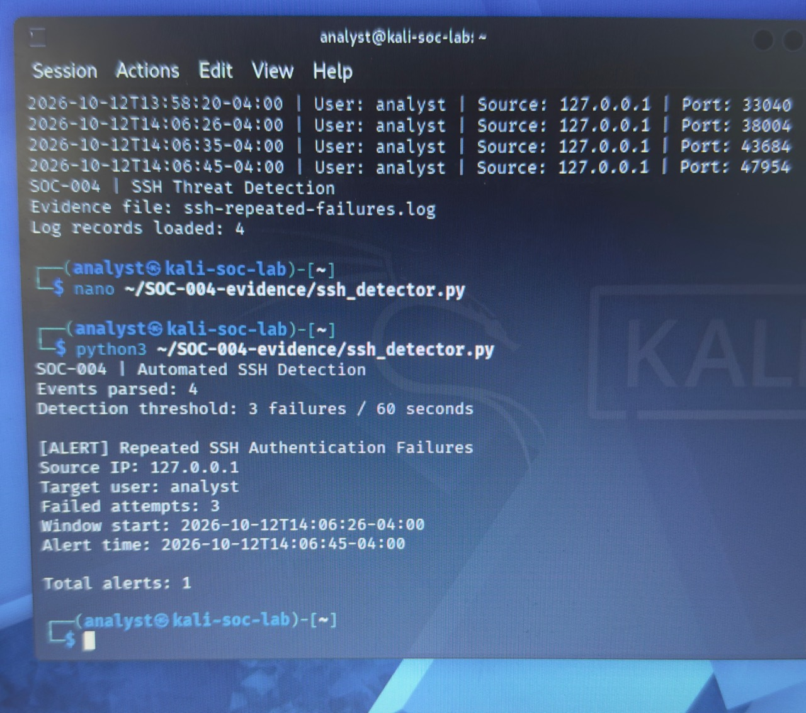
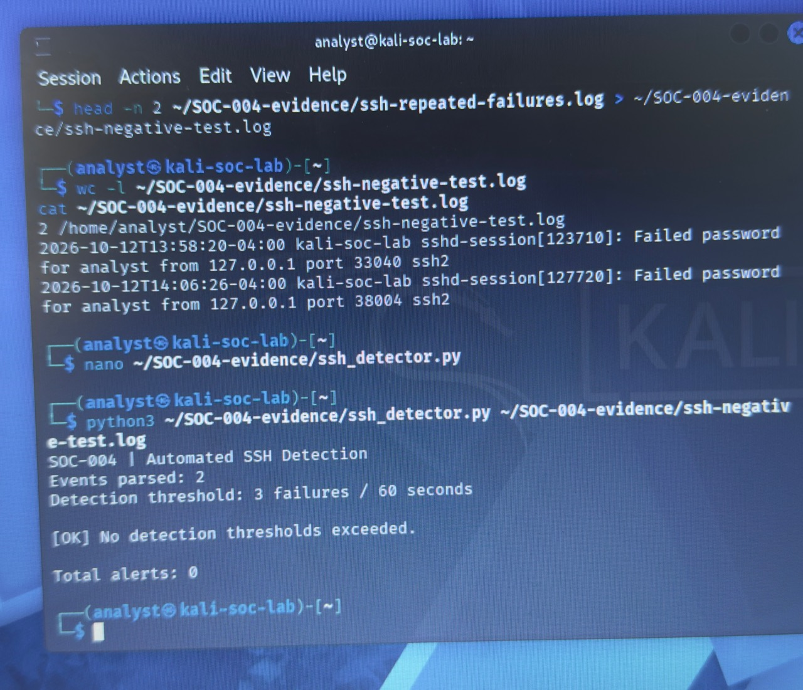
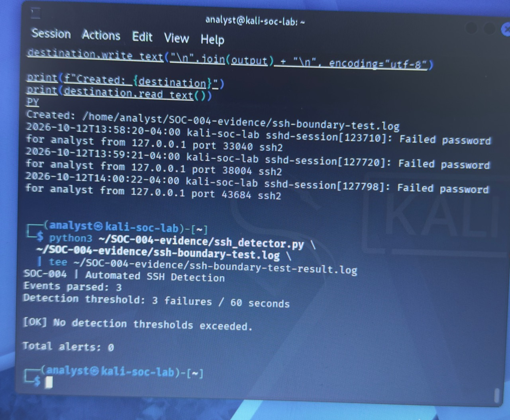

# SOC-004 — Automated SSH Authentication Failure Detection

**Status:** Completed controlled exercise; publication approved by the user on 2026-10-12  
**Investigation type:** Linux SSH journal analysis and Python detection validation  
**Environment:** Kali Linux VM `kali-soc-lab`, lab account `analyst`, localhost `127.0.0.1`  
**Disposition:** Authorized lab activity; no confirmed real-world security incident  
**Evidence basis:** Ten transferred source/log/result files, their original SHA256 manifest, the historically attributed exact user-pasted detector source, independently reproduced results, and 26 preserved JPEG uploads covering setup, original journal collection, detector development, and all four original detector scenarios; the boundary fixtures are synthetic.

## Objective and scope

Detect at least three SSH password failures for the same source IP and target username within an inclusive 60-second sliding window. Validate the positive, negative, outside-window, and exact-boundary scenarios while keeping original localhost journal evidence distinct from synthetic tests.

The reviewed exports represent a personally controlled lab. A detector alert establishes that the configured failure pattern was present in its input; it does not establish successful access or compromise.

## Collection, preservation, and publication handling

The user transferred the existing `SOC-004-evidence` directory from Kali through a temporary VirtualBox shared folder. The ten artifacts named in the supplied `SHA256SUMS.txt` were hashed independently using `hashlib.sha256` over their raw bytes: **10 of 10 matched**. The underlying live journal was not independently inspected. Subsequently supplied photographs now show the bounded first-failure export and repeated-failure selection commands; they do not provide a raw journal acquisition or full terminal-session record.

The supplied source, nine log/result files, and manifest are preserved byte-for-byte in [`evidence/SOC-004/`](../evidence/SOC-004/README.md). The manifest remains unchanged and uses the original filenames relative to that directory. The transferred compiled Python cache is not part of the evidence manifest and is excluded from publication.

Review of the supplied excerpts found the established lab hostname/account and loopback addresses, with no password values, credentials, or non-loopback source addresses. No additional redaction was necessary for the approved publication copies. No file text was rewritten, and the earlier sanitization or export history is not independently authenticated.

Hash matching confirms that the transferred bytes agree with the supplied manifest. It does not authenticate the original journal acquisition or prove an unbroken chain of custody before transfer.

### Recovered exact-boundary photograph

On **2026-10-12**, the original cached upload `IMG_2551.jpeg` was recovered from the earlier conversation's attachment-preview files. The earlier SOC-004 preparation chat records viewing the same attachment. Its bytes were copied unchanged to [SOC-004-exact-boundary-terminal-original.jpeg](../evidence/SOC-004/SOC-004-exact-boundary-terminal-original.jpeg); both accessible cached copies have the same SHA256 digest. The JPEG contains one 1536 × 1300 frame and retains its embedded metadata. [Provenance and recovery limits](../evidence/SOC-004/photograph-provenance.json) and a [separate photograph hash inventory](../evidence/SOC-004/photographs.sha256) accompany it.



*The photograph shows three synthetic failure records at 13:58:20, 13:58:50, and 13:59:20 (`-04:00`), followed by three parsed events and one alert spanning exactly 60 seconds. The displayed input and result agree with the preserved [exact-boundary fixture](../evidence/SOC-004/ssh-exact-boundary-test.log) and [saved result](../evidence/SOC-004/ssh-exact-boundary-test-result.log). The constructed timestamps describe the test input, not camera acquisition or live SSH activity.*

Two supplied batches totaling 25 JPEG uploads are now preserved and indexed below, in addition to the recovered exact-boundary JPEG. All four original scenario results now have photographed views. Only the final detector syntax/complete ten-file checksum photograph remains unavailable. The latest exact-boundary upload depicts the same terminal view as the cached JPEG with different bytes; the 26-file count does not assert 26 independent camera acquisitions.

### Twenty additional supplied photographs

The user supplied these JPEGs directly on **2026-10-12**, labeled Photo 1.jpg through Photo 20.jpg. Their uploaded bytes and metadata are preserved unchanged. The [photograph provenance](../evidence/SOC-004/photograph-provenance.json) maps every label to its repository filename and digest; the [photograph inventory](../evidence/SOC-004/photographs.sha256) now verifies **26 JPEG files**, including the separately recovered exact-boundary photograph. Upload numbering is retained without claiming authenticated acquisition chronology.

| Upload | Original photograph | Visible content and limits |
| --- | --- | --- |
| Photo 1 | [SSH service initially inactive](../evidence/SOC-004/SOC-004-01-ssh-inactive-original.jpg) | The initial systemctl status shows ssh.service loaded but inactive (dead) and disabled. |
| Photo 2 | [SSH service started with wildcard listeners](../evidence/SOC-004/SOC-004-02-ssh-started-wildcard-original.jpg) | systemctl start/status shows the service active since 2026-10-12 13:33:54 EDT; its journal records wildcard IPv4 and IPv6 listeners. This precedes loopback restriction. |
| Photo 3 | [Initial wildcard socket check](../evidence/SOC-004/SOC-004-03-wildcard-socket-check-original.jpg) | The ss output shows 0.0.0.0:22 and [::]:22 with sshd PID 111930. These are initial wildcard bindings, not the later loopback-only state. |
| Photo 4 | [Configuration before the loopback edit](../evidence/SOC-004/SOC-004-04-sshd-config-before-change-original.jpg) | GNU nano 9.2 displays sshd_config, its Include directive, and commented ListenAddress defaults. The photograph does not show an active loopback directive. |
| Photo 5 | [Configuration backup and syntax check](../evidence/SOC-004/SOC-004-05-config-backup-and-syntax-original.jpg) | The terminal shows a backup to sshd_config.soc004.bak, an editor invocation, and sshd -t followed by SSH configuration valid. Syntax validity does not establish loopback binding. |
| Photo 6 | [Effective configuration still wildcard](../evidence/SOC-004/SOC-004-06-effective-wildcard-config-original.jpg) | After the syntax check, sshd -T reports [::]:22 and 0.0.0.0:22. The initial edit had not established loopback-only listening. |
| Photo 7 | [ListenAddress investigation](../evidence/SOC-004/SOC-004-07-listenaddress-investigation-original.jpg) | The terminal shows searches for active ListenAddress directives and numbered commented defaults in sshd_config, while the effective configuration above still shows wildcard addresses. |
| Photo 8 | [Loopback configuration and socket verified](../evidence/SOC-004/SOC-004-08-loopback-binding-verified-original.jpg) | The terminal shows an active ListenAddress 127.0.0.1 directive, successful sshd -t, effective 127.0.0.1:22, service restart, and an ss listener at 127.0.0.1:22 with sshd PID 122186. |
| Photo 9 | [SSH service restart journal](../evidence/SOC-004/SOC-004-09-ssh-service-journal-original.jpg) | journalctl displays the initial wildcard startup at 13:33:54 and restart at 13:54:58 with a listener on 127.0.0.1 port 22. The short timestamp display omits an explicit offset. |
| Photo 10 | [First localhost login failure](../evidence/SOC-004/SOC-004-10-first-localhost-login-failure-original.jpg) | The localhost password-only SSH attempt shows host-key acceptance, a password prompt with no password value displayed, and Permission denied (publickey,password). |
| Photo 11 | [First failure journal context](../evidence/SOC-004/SOC-004-11-first-failure-journal-original.jpg) | Filtered journal output shows password/PAM failure at 13:58:18 and failed password plus pre-authentication closure at 13:58:20, for analyst from 127.0.0.1 port 33040. |
| Photo 12 | [Bounded first-failure journal export](../evidence/SOC-004/SOC-004-12-first-failure-export-original.jpg) | The terminal shows journalctl --since 2026-10-12 13:57:00 --until 2026-10-12 14:00:00 with short-iso output redirected to ssh-first-failure.log, then wc/cat displaying four records with -04:00 timestamps. |
| Photo 13 | [First-failure hash and repeated attempts](../evidence/SOC-004/SOC-004-13-first-failure-hash-and-attempts-original.jpg) | The displayed SHA256 of ssh-first-failure.log matches the preserved file and original manifest. Three further localhost SSH commands end in Permission denied; password values are not displayed. |
| Photo 14 | [Journal command error preserved](../evidence/SOC-004/SOC-004-14-journal-command-error-original.jpg) | An attempted journal query uses --no pager and returns an ambiguous --no option error. This failed query is preserved as photographed and is not evidence of a successful export. |
| Photo 15 | [Corrected journal query](../evidence/SOC-004/SOC-004-15-corrected-failure-query-original.jpg) | The corrected --no-pager query displays four failed-password events at 13:58:20, 14:06:26, 14:06:35 and 14:06:45 (-04:00). The earlier command error remains visible above it. |
| Photo 16 | [Repeated-failure export](../evidence/SOC-004/SOC-004-16-repeated-failures-export-original.jpg) | The corrected journal query is redirected to ssh-repeated-failures.log; wc/cat displays four records agreeing with the preserved original selection. |
| Photo 17 | [Repeated-failure hash, Python version and early detector](../evidence/SOC-004/SOC-004-17-repeated-hash-and-python-original.jpg) | The displayed SHA256 of ssh-repeated-failures.log matches the preserved file and manifest. python3 --version shows 3.14.7. An earlier detector stage prints SSH Threat Detection and Log records loaded: 4; it is not the final saved detector output. |
| Photo 18 | [Intermediate parser development](../evidence/SOC-004/SOC-004-18-parser-development-stage-original.jpg) | The photograph shows four parsed timestamp/user/source/port records and earlier SSH Threat Detection output. It records an intermediate detector stage; that version of the source has not been recovered. |
| Photo 19 | [Positive detector test](../evidence/SOC-004/SOC-004-19-positive-detector-alert-original.jpg) | The final Automated SSH Detection display reports four parsed events, threshold 3 failures / 60 seconds, and one alert with three failures from 14:06:26 to 14:06:45 (-04:00), matching ssh-detection-alert.log. |
| Photo 20 | [Saved positive result displayed](../evidence/SOC-004/SOC-004-20-saved-positive-result-original.jpg) | cat ssh-detection-alert.log displays four parsed events and one alert for the three failures from 14:06:26 to 14:06:45 (-04:00), agreeing with the preserved saved result. |

#### SSH configuration and scope

Photos 2–7 show the initial wildcard listeners at `0.0.0.0:22` and `[::]:22`. **Photo 8** shows the later active `ListenAddress 127.0.0.1` setting, configuration validation, service restart, and actual loopback listener. Photo 9 corroborates the service restart at displayed journal time 13:54:58. Loopback describes the subsequent authentication exercise; it does not describe the initial startup state or imply that the NAT VM was air-gapped.



*Photo 8: the displayed effective configuration and socket output both show `127.0.0.1:22`; the earlier wildcard state is retained in the preceding photographs.*

#### Journal export and individual hash observations

Photo 12 shows `journalctl` with displayed bounds `2026-10-12 13:57:00` through `2026-10-12 14:00:00`, `--no-pager` and `-o short-iso`, redirected to `ssh-first-failure.log`; `wc` and `cat` display four records. Photo 16 shows the repeated-failure selection redirected to `ssh-repeated-failures.log`, again with four records. The displayed records agree with the preserved files and retain `-04:00`. Photo 14 preserves an unsuccessful `--no pager` query; Photos 15–16 show the corrected `--no-pager` query. The failed query is not represented as a successful export.



*Photo 12: photographed export command and displayed output. This supplements the transferred file; it does not authenticate the full underlying journal or prior collection history.*

The SHA256 values photographed in Photo 13 (`ssh-first-failure.log`) and Photo 17 (`ssh-repeated-failures.log`) agree with the corresponding preserved bytes and original manifest entries. Only these two individual hash observations are shown; the final ten-file checksum photograph remains unavailable.

#### Detector development and positive result

Photos 17–18 show the Kali `python3 --version` output **3.14.7** and earlier loader/parser output. These are intermediate stages; their source versions are not available, and their wording is not attributed to the final preserved detector. This photographed Kali version is distinct from the **Python 3.14.8 on Windows** historical replay reported below.

Photos 19–20 show the final positive result: four parsed events, a threshold of three failures in 60 seconds, and one alert spanning `14:06:26-04:00` to `14:06:45-04:00`. Photo 20 displays the saved `ssh-detection-alert.log`; its visible output agrees with the preserved file.



*Photo 19: the final three original failed-password events span 19 seconds and produce one alert. The older 13:58:20 event is counted among four parsed events but expires from the alert window.*

### Negative and synthetic boundary-test uploads

The second supplied batch is cataloged as **21–25**, while retaining its user-facing labels Photo 1.jpg through Photo 5.jpg. Each uploaded JPEG is preserved unchanged, with its batch identity and byte digest in the [provenance record](../evidence/SOC-004/photograph-provenance.json).

| Catalog / second-batch upload | Original image | Visible content and limits |
| --- | --- | --- |
| 21 / Photo 1 | [Negative subset extraction and result](../evidence/SOC-004/SOC-004-21-negative-test-original.jpg) | The terminal shows head -n 2 extracting the first two original repeated-failure records to ssh-negative-test.log, followed by wc/cat and a detector run reporting two parsed events and zero alerts. The records are 486 seconds apart; this does not isolate two failures within one 60-second window. |
| 22 / Photo 2 | [Synthetic outside-window fixture creation](../evidence/SOC-004/SOC-004-22-outside-window-fixture-original.jpg) | A visible generator fragment retains the suffixes of the first three source records and replaces their timestamps with start + 61 seconds × index. Its displayed ssh-boundary-test.log contains 13:58:20, 13:59:21 and 14:00:22 (-04:00), agreeing with the preserved synthetic fixture. The full generator source is not visible or recovered as a file. |
| 23 / Photo 3 | [Synthetic outside-window detector result](../evidence/SOC-004/SOC-004-23-outside-window-result-original.jpg) | The terminal shows the constructed three-record fixture and a detector invocation piped through tee to ssh-boundary-test-result.log. The result reports three parsed events and zero alerts, agreeing with the saved result. These timestamps are synthetic test values, not live authentication events. |
| 24 / Photo 4 | [Synthetic exact-boundary fixture creation](../evidence/SOC-004/SOC-004-24-exact-boundary-fixture-original.jpg) | A visible generator fragment uses offsets [0, 30, 60], retaining source-record suffixes while replacing timestamps. The displayed records at 13:58:20, 13:58:50 and 13:59:20 (-04:00) agree with the preserved synthetic exact-boundary fixture. Only a generator fragment is visible. |
| 25 / Photo 5 | [Exact-boundary result, second upload](../evidence/SOC-004/SOC-004-25-exact-boundary-result-upload-original.jpg) | The terminal shows the synthetic exact-boundary fixture and a detector invocation piped through tee to ssh-exact-boundary-test-result.log. Three parsed events produce one alert from 13:58:20 to 13:59:20 (-04:00), agreeing with the saved result. This depicts the same terminal view as the earlier recovered JPEG; the uploaded bytes differ, and a separate acquisition is not authenticated. |

Second-batch Photo 1 supplies the previously unavailable negative-subset command: `head -n 2` selects the first two original repeated-failure records. Its detector output shows two events and zero alerts, matching the preserved [negative input](../evidence/SOC-004/ssh-negative-test.log) and [saved result](../evidence/SOC-004/ssh-negative-test-result.log). The events are 486 seconds apart, so the count and window conditions are not isolated by this historical test.



*Catalog 21 / second-batch Photo 1: two original selected records, two parsed events, zero alerts. The photographed extraction command supplements the previously established byte-identical subset relationship.*

Second-batch Photos 2–3 show the **synthetic outside-window fixture** with timestamps at offsets 0, 61 and 122 seconds, then three parsed events and zero alerts. Photo 2 shows a generator fragment replacing timestamp prefixes while preserving the remaining fields of the first three source records. The visible records and result agree with [ssh-boundary-test.log](../evidence/SOC-004/ssh-boundary-test.log) and [its saved output](../evidence/SOC-004/ssh-boundary-test-result.log).



*Catalog 23 / second-batch Photo 3: three constructed timestamps 61 seconds apart yield zero alerts. These test timestamps do not establish historical live authentication events.*

Second-batch Photos 4–5 show the **synthetic exact-boundary fixture** with offsets 0, 30 and 60 seconds and a result of three events and one alert, agreeing with the preserved [fixture](../evidence/SOC-004/ssh-exact-boundary-test.log) and [saved result](../evidence/SOC-004/ssh-exact-boundary-test-result.log). Only fragments of the boundary generators are visible; the complete original generator source files and the source/destination setup omitted from the photographs have not been recovered. No generator file is reconstructed from these photographs.

Catalog 25 / second-batch Photo 5 shows the same exact-boundary terminal view as the previously [recovered JPEG](../evidence/SOC-004/SOC-004-exact-boundary-terminal-original.jpeg), with different SHA256 bytes and dimensions. Both supplied versions are retained; independent acquisition is not asserted. The repository now holds **26 preserved JPEG files**, including those two views, rather than evidence of 26 separate acquisitions.

## Detector source and behavior

The historical runnable [detector under `detections/SOC-004/`](../detections/SOC-004/ssh_detector.py) is preserved unchanged. The earlier publication identified it as the exact user-pasted text; the cached conversation available to this remediation does not expose that source text, so this attribution is retained as a historical publication claim rather than newly authenticated. The [transferred original `ssh_detector.py`](../evidence/SOC-004/ssh_detector.py) is also preserved with the evidence, so its original manifest entry can be verified without modifying paths or file bytes.

The transferred source equals one leading LF byte, the exact pasted text, and two trailing LF bytes. There are no other differences. Both source copies passed syntax compilation and produced the same results on all four original scenario inputs. The separate copies preserve the chat source and the original file's hash without changing either.

The detector:

- Reads the first command-line argument as an input path, or defaults to `~/SOC-004-evidence/ssh-repeated-failures.log`.
- Matches timestamped lines ending in `Failed password for <username> from <source_ip> port <port> ssh2`.
- Parses timestamps, sorts events, and maintains a deque per `(source_ip, username)`.
- Removes timestamps only when their age is **greater than 60 seconds**. An event exactly 60 seconds old remains in the window.
- Emits an alert at three retained failures and at most one alert per source-IP/username pair per invocation.

## Evidence inventory and provenance

| Artifact | Role and provenance |
| --- | --- |
| [`ssh-first-failure.log`](../evidence/SOC-004/ssh-first-failure.log) | Original localhost SSH journal excerpt: password check, PAM failure, failed password, and pre-authentication connection closure |
| [`ssh-repeated-failures.log`](../evidence/SOC-004/ssh-repeated-failures.log) | Original localhost SSH journal selection: four failed-password records |
| [`ssh-detection-alert.log`](../evidence/SOC-004/ssh-detection-alert.log) | Derived detector output for the original repeated-failures selection |
| [`ssh-negative-test.log`](../evidence/SOC-004/ssh-negative-test.log) | Journal-derived negative test subset: byte-identical records to the first two lines of the repeated-failures selection; the second-batch Photo 1 now shows extraction with `head -n 2` |
| [`ssh-negative-test-result.log`](../evidence/SOC-004/ssh-negative-test-result.log) | Derived detector output for the negative subset |
| [`ssh-boundary-test.log`](../evidence/SOC-004/ssh-boundary-test.log) | **Synthetic** boundary fixture with failures 61 seconds apart; not original journal evidence |
| [`ssh-boundary-test-result.log`](../evidence/SOC-004/ssh-boundary-test-result.log) | Derived detector output for the synthetic outside-window fixture |
| [`ssh-exact-boundary-test.log`](../evidence/SOC-004/ssh-exact-boundary-test.log) | **Synthetic** exact-boundary fixture with offsets 0, 30, and 60 seconds; not original journal evidence |
| [`ssh-exact-boundary-test-result.log`](../evidence/SOC-004/ssh-exact-boundary-test-result.log) | Derived detector output for the synthetic exact-boundary fixture |
| [`ssh_detector.py`](../evidence/SOC-004/ssh_detector.py) | Original transferred detector file, included in the ten-file manifest |

The two synthetic boundary fixtures reuse lab-style hostname, account, loopback address, PID, and port fields. Their timestamps are constructed test values and do not establish that those SSH events occurred at those times. Detector output is a derived result, not a journal export.

## Original journal observations and alert timeline

All timestamps below come from the supplied original journal excerpts and retain their recorded `-04:00` offset.

| Time on 2026-10-12 | Supplied observation |
| --- | --- |
| 13:58:18 | `unix_chkpwd` password-check failure and `pam_unix(sshd:auth)` authentication failure for `analyst` |
| 13:58:20 | Failed SSH password from `127.0.0.1`, port `33040`; connection closed before authentication |
| 14:06:26 | Failed SSH password from `127.0.0.1`, port `38004` |
| 14:06:35 | Failed SSH password from `127.0.0.1`, port `43684` |
| 14:06:45 | Failed SSH password from `127.0.0.1`, port `47954`; the detector reaches its threshold |

The positive input contains **four** matching events. The first event is 486 seconds before the next and expires from the active window. The final three failures occur over **19 seconds**, producing one alert with window start **14:06:26-04:00** and alert time **14:06:45-04:00**.

The initial password/PAM records and connection closure provide context, but only the matching `Failed password` line is counted by this detector. No successful authentication is shown in the supplied excerpts; they do not establish the full session or host history.

## Four validated original scenarios

On **2026-10-12**, the transferred original inputs were replayed with **Python 3.14.8 on Windows**, using both the exact pasted-source copy and the transferred-source copy. Both passed all four scenarios.

| Scenario | Supplied input | Parsed events | Expected / actual alerts | Result |
| --- | --- | ---: | ---: | --- |
| Positive: threshold reached | Four original journal failures; final three at 14:06:26, 14:06:35, and 14:06:45 | 4 | 1 / 1 | PASS |
| Negative: fewer than three failures | First two original failure records, 486 seconds apart | 2 | 0 / 0 | PASS |
| Outside-window boundary | Synthetic timestamps 13:58:20, 13:59:21, 14:00:22; offsets 0, 61, 122 seconds | 3 | 0 / 0 | PASS |
| Exact 60-second boundary | Synthetic timestamps 13:58:20, 13:58:50, 13:59:20; offsets 0, 30, 60 seconds | 3 | 1 / 1 | PASS |

The original negative fixture is below threshold and also outside the window; it does not isolate the count condition inside a single 60-second window. The earlier preparation run separately checked two failures at offsets 0 and 30 seconds.

For each original scenario, parsed counts and alert totals were checked, and **the complete rerun output matched the saved Kali result log** after normalizing CRLF to LF for comparison. The published original evidence bytes were not normalized or edited.

[Original-evidence validation results](../evidence/SOC-004/original-evidence-validation.json) record all ten hashes, both syntax results, source-copy differences, and the four replay comparisons. The previously reviewed exact-boundary terminal photograph has now been recovered and is linked above for reinspection. It shows three parsed events and one alert, consistent with the preserved synthetic fixture and saved result. The newly supplied positive-test photographs also corroborate its preserved result. The second batch now supplies negative and outside-window result photographs, and the latest exact-boundary view also agrees with its preserved fixture and result. All four scenario results have photographic views alongside the preserved inputs, saved outputs and independent replay records.

The [earlier preparation-run results](../evidence/SOC-004/publication-preparation-validation.json) remain separately labeled. They used freshly generated artificial inputs with a 2000-01-01 baseline and do not replace the user's Kali evidence or its saved outputs. The exact old generator/input bytes were not preserved, so that historical preparation run cannot be independently reconstructed in full.

The [new synthetic test package](../tests/SOC-004/README.md) separately preserves a deterministic generator, inputs, expected outputs, and an output-checking runner. It includes two failures within 30 seconds, plus within-window, outside-window, exact-boundary, grouping, sorting, and deduplication cases. It uses the recorded old offsets for four new fixtures without claiming to recover the old fixture bytes. New files remain outside the unchanged original manifest.

## Syntax and ten-file SHA256 verification

Both source copies passed `py_compile.compile(..., doraise=True)`. The original [`SHA256SUMS.txt`](../evidence/SOC-004/SHA256SUMS.txt) contains ten supplied digest values, and all ten independently matched the transferred raw bytes.

Photos 13 and 17 separately show the first-failure and repeated-failure log hashes, both matching the corresponding manifest entries. A photograph of the final detector syntax/complete ten-file checksum check is still unavailable.

The [user-reported ten-line check](../evidence/SOC-004/user-reported-sha256-check.txt) is retained as a historical transcript. It is distinct from the manifest and from the new independent verification results.

From the repository root, the following Linux commands reproduce syntax and original-file integrity checks:

```sh
python3 tests/SOC-004/run_tests.py
(
  cd evidence/SOC-004
  sha256sum -c SHA256SUMS.txt
)
```

The manifest covers the **original evidence-directory detector**, not the separate pasted-source copy, report, manifest itself, or newly generated validation JSON. The two source files have different hashes because of their documented outer blank lines.

Replay the original scenarios with:

```sh
python3 detections/SOC-004/ssh_detector.py evidence/SOC-004/ssh-repeated-failures.log
python3 detections/SOC-004/ssh_detector.py evidence/SOC-004/ssh-negative-test.log
python3 detections/SOC-004/ssh_detector.py evidence/SOC-004/ssh-boundary-test.log
python3 detections/SOC-004/ssh_detector.py evidence/SOC-004/ssh-exact-boundary-test.log
```

The expected alert totals are **1, 0, 0, 1**, respectively. The test runner compiles source in memory and compares complete outputs for both historical sources without adding caches to the evidence directory.

## Newly proposed collection and optional hardened detector

The [fresh-lab walkthrough](../docs/reproduction.md) documents loopback service prerequisites, ISO timestamp exports, new fixture generation, hashing and cleanup. Its commands are new proposals, not recovered historical commands, and no live authentication attempts were performed during this sprint.

An optional [hardened detector](../detections/SOC-004/ssh_detector_v2.py) is a new implementation for future offline use. It requires an explicit input path and timezone-aware ISO timestamps, includes `invalid user` failed-password lines, reports skipped record counts on stderr, and exits 2 on unreadable input or malformed failed-password records before printing any detection result. Exit 0 means successful parsing/analysis within its documented format, not evidence that the host is clean. It preserves the inclusive 60-second rule and one-alert-per-pair behavior. Tests cover it separately; neither historical source nor historical saved output has been updated to represent this new behavior.

## Analysis and limitations

The original positive case and two synthetic boundary fixtures validate the configured threshold and inclusive window behavior for matching lines. Original and pasted-source copies reproduce the saved outputs without logic changes.

The preserved detector has a limited scope:

- It does not match every SSH authentication message. In particular, `Failed password for invalid user ...` does not match the supplied pattern.
- Nonmatching lines are silently skipped. Zero alerts do not prove that an input contains no authentication failures.
- Malformed matched timestamps can raise an exception; mixing timezone-aware and timezone-naive timestamps can also fail.
- A missing file prints an error and returns without an explicit nonzero exit status. A process exit status alone is insufficient to validate a run.
- Deduplication lasts only for the invocation. Grouping by source IP and username does not detect distributed activity across different pairs.
- This is an offline text-file detector. No live journal ingestion, SIEM integration, automated blocking, or production deployment is claimed.

The report covers the supplied localhost excerpts and fixture results. It does not establish the full journal history, independently authenticate collection, or assess the entire host for compromise.

## Disposition and merge gate

**Authorized controlled localhost exercise / no confirmed real-world security incident.** The transferred artifacts pass ten-file integrity verification, both syntax checks, and all four original scenario replays within the documented scope.

The evidence, detector, results, report, and README index were prepared in a separate draft PR and held for user review. On **2026-10-12**, the user explicitly approved merging after the ten-file integrity checks, syntax checks, and all four original scenario replays passed. The required approval gate was satisfied before that historical merge (PR #10). The documentation remediation and new tests were subsequently merged in [PR #11](https://github.com/levetteit/cybersecurity-operations-lab/pull/11) on 2026-10-12. This photograph recovery is a separate follow-up draft for user approval before merge.

## Lessons learned

- Validate both the event-count threshold and the inclusive time boundary.
- Keep original journal records, synthetic fixtures, and detector-derived output distinct.
- Preserve original bytes and manifest paths when asserting hash integrity.
- Compare complete outputs, document source-format differences, and state collection limitations.
